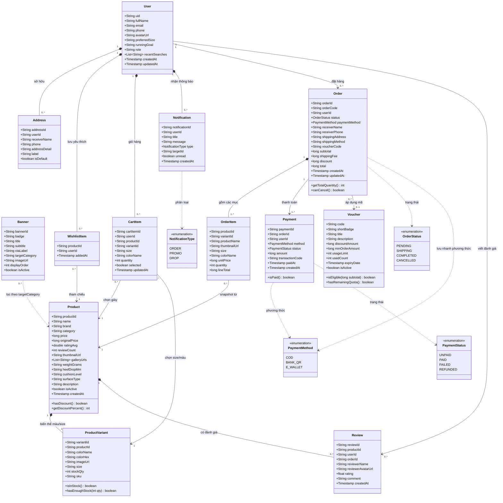
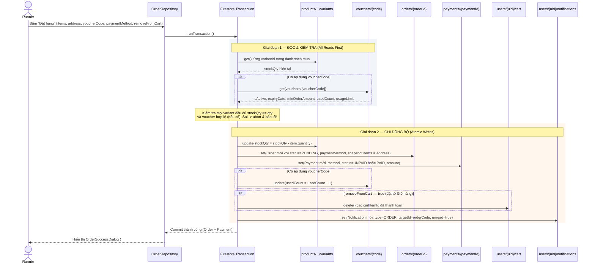
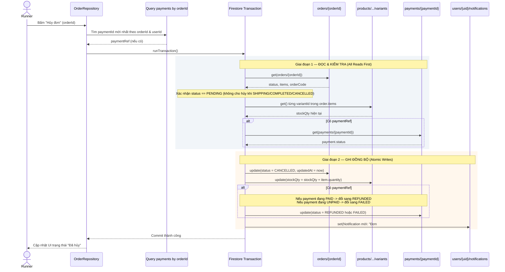

# Thiết kế Cơ sở dữ liệu — Shoes Store (Firebase Auth & Cloud Firestore)

Tài liệu này mô tả mô hình dữ liệu, cấu trúc collection trên **Cloud Firestore**, cách hiển thị phương thức thanh toán trên màn hình Chi tiết đơn hàng (`OrderDetailActivity`), và quy trình đồng bộ giao dịch (**Firestore Transaction**) cho nghiệp vụ **Đặt hàng** & **Hủy đơn**.

---

## 1. Class Diagram

Nguồn Mermaid gốc: [class_diagram.mmd](./class_diagram.mmd)



---

## 2. Ánh xạ Collection trên Cloud Firestore

| Lớp | Đường dẫn Firestore | Quy ước lưu trữ |
| --- | --- | --- |
| `User` | `users/{uid}` | Document ID trùng `uid` của Firebase Auth; `avatarUrl` lưu link ảnh; `preferredSize` lưu chuẩn **EU** dạng `String` (vd `"40.5"`, `"42"`). |
| `Address` | `users/{uid}/addresses/{addressId}` | Sổ địa chỉ riêng của từng tài khoản; cờ `isDefault` xác định địa chỉ mặc định khi thanh toán. |
| `WishlistItem` | `users/{uid}/wishlist/{productId}` | Dùng `productId` làm document ID để chống trùng và kiểm tra yêu thích theo $O(1)$. |
| `CartItem` | `users/{uid}/cart/{cartItemId}` | Lưu `productId`, `variantId`, `size` (EU), `colorName`, `quantity`, `selected`; giá sản phẩm luôn lấy trực tiếp từ `products/{productId}` để đồng bộ giá mới nhất. |
| `Notification` | `users/{uid}/notifications/{notificationId}` | Lưu `targetId` (`orderCode`, `productId` hoặc `voucherCode`) và `createdAt` dạng `Timestamp`. |
| `Banner` | `banners/{bannerId}` | Lọc `isActive == true`, sắp xếp tăng dần theo `displayOrder`. |
| `Product` | `products/{productId}` | Lưu thông tin chính, thông số chạy bộ (`weightGrams`, `heelDropMm`, `cushionLevel`, `surfaceType`), `thumbnailUrl` và `galleryUrls`. |
| `ProductVariant` | `products/{productId}/variants/{variantId}` | Gộp thông tin phối màu (`colorName`, `colorHex`, `imageUrl`) và size EU (`size`) cùng tồn kho thực tế (`stockQty`, `sku`). |
| `Review` | `products/{productId}/reviews/{reviewId}` | Tách subcollection theo sản phẩm để dễ phân trang và sắp xếp theo `createdAt`. |
| `Voucher` | `vouchers/{code}` | Document ID là mã voucher viết hoa (vd `RUN50K`) để tra cứu trực tiếp bằng `doc(code)`. |
| `Order` | `orders/{orderId}` | Collection gốc có `userId` (để khách xem đơn của mình và admin lọc toàn hệ thống); nhúng `items: List<OrderItem>` và lưu snapshot địa chỉ + `paymentMethod`. |
| `Payment` | `payments/{paymentId}` | Tách riêng lịch sử giao dịch thanh toán theo `orderId` và `userId`; lưu `method`, `status`, `amount`, `transactionCode`, `paidAt`. |

---

## 3. Chiến lược hiển thị Phương thức thanh toán trên `OrderDetailActivity`

Để vừa **giảm lượt đọc Firestore** vừa giữ **lịch sử giao dịch chuẩn thực tế**, hệ thống áp dụng cơ chế kết hợp 2 lớp:

1. **Lưu dự phòng `paymentMethod` trực tiếp trên `Order`**:
   - Khi mở màn **Lịch sử đơn hàng (`OrderHistoryActivity`)** hoặc **Chi tiết đơn hàng (`OrderDetailActivity`)**, chỉ cần đọc 1 document `orders/{orderId}` là có thể hiển thị ngay dòng `shippingMethod · paymentMethod` (vd: *"Giao tiêu chuẩn · Thanh toán khi nhận hàng (COD)"*), không bị độ trễ hay phát sinh $N$ truy vấn phụ cho từng đơn.
2. **Truy vấn thêm `payments` theo `orderId` khi cần chi tiết giao dịch**:
   - Tại `OrderDetailActivity`, truy vấn:
     ```text
     payments
       .whereEqualTo("orderId", order.orderId)
       .whereEqualTo("userId", currentUid)
       .orderBy("createdAt", DESCENDING)
       .limit(1)
     ```
   - Lấy bản ghi `Payment` mới nhất để hiển thị thêm trạng thái thanh toán (`UNPAID` / `PAID` / `FAILED` / `REFUNDED`), mã giao dịch (`transactionCode`) và thời gian thanh toán (`paidAt`).

---

## 4. Quy trình đồng bộ Firestore Transaction cho Đặt hàng & Hủy đơn

> **Nguyên tắc bắt buộc của Cloud Firestore Transaction**: Toàn bộ thao tác **ĐỌC (`transaction.get(...)`)** phải hoàn tất **trước** khi thực hiện bất kỳ thao tác **GHI (`set` / `update` / `delete`)** nào. Nếu bất kỳ điều kiện tồn kho hoặc voucher nào không đạt, transaction sẽ ném lỗi và tự động **rollback toàn bộ**, đảm bảo không bao giờ xảy ra lệch kho hay tạo đơn thiếu bản ghi thanh toán.

### 4.1. Luồng Đặt hàng (`placeOrder`)



**Chi tiết từng bước kiểm tra & ghi trong `placeOrder`**:
1. **Kiểm tra tồn kho**: Với mỗi `item` trong `checkoutItems`, đọc `products/{item.productId}/variants/{item.variantId}`. Nếu document không tồn tại hoặc `stockQty < item.quantity` → hủy transaction với thông báo *"Sản phẩm [tên] size [size] không đủ số lượng trong kho"*.
2. **Kiểm tra Voucher (nếu `voucherCode != null`)**: Đọc `vouchers/{voucherCode}`. Kiểm tra `isActive == true`, `expiryDate > now`, `subtotal >= minOrderAmount`, và `usedCount < usageLimit` (khi `usageLimit > 0`). Nếu không đạt → hủy transaction.
3. **Trừ tồn kho**: Cập nhật `stockQty = currentStock - item.quantity` cho từng biến thể đã đọc.
4. **Tạo `Order`**: Ghi `orders/{orderId}` với `status = PENDING`, `paymentMethod`, snapshot `receiverName`, `receiverPhone`, `shippingAddress`, mảng `items` (`OrderItem` giữ sẵn `variantId` & `unitPrice`), `subtotal`, `shippingFee`, `discount`, `total`, `createdAt`, `updatedAt`.
5. **Tạo `Payment`**: Ghi `payments/{paymentId}` với `orderId`, `userId`, `method = paymentMethod`, `amount = total`, `status = UNPAID` (với `COD`; hoặc `PAID` kèm `transactionCode` & `paidAt` sau khi xác nhận thanh toán online).
6. **Cập nhật lượt dùng Voucher**: Nếu có áp mã, tăng `vouchers/{voucherCode}.usedCount` thêm `1`.
7. **Dọn giỏ hàng**: Nếu `removeFromCart == true` (không phải luồng *Mua ngay*), xóa các document `users/{uid}/cart/{cartItemId}` tương ứng.
8. **Tạo thông báo**: Thêm document `users/{uid}/notifications/{notificationId}` (`type = ORDER`, `targetId = orderCode`, `unread = true`).

---

### 4.2. Luồng Hủy đơn (`cancelOrder`)



**Lưu ý kỹ thuật cho `cancelOrder`**:
- Firestore Transaction không hỗ trợ chạy câu `Query` trực tiếp bên trong callback transaction trên Android SDK, nên cần **tìm `paymentRef` trước** (theo `orderId` + `userId`), sau đó truyền `DocumentReference` đó vào trong `runTransaction` để đọc (`transaction.get(paymentRef)`) và cập nhật an toàn.
- Chỉ cho phép hủy khi `order.status == OrderStatus.PENDING` (`order.canCancel() == true`).
- Với mỗi `OrderItem` trong `order.items`, cộng trả chính xác `item.quantity` về `products/{item.productId}/variants/{item.variantId}.stockQty`.

---

## 5. Gợi ý Firestore Security Rules (khi chuyển từ Test mode sang bảo mật)

```javascript
rules_version = '2';
service cloud.firestore {
  match /databases/{database}/documents {
    function isSignedIn() {
      return request.auth != null;
    }
    function isOwner(uid) {
      return isSignedIn() && request.auth.uid == uid;
    }

    // Dữ liệu cá nhân dưới users/{uid}
    match /users/{uid} {
      allow read, write: if isOwner(uid);

      match /{subcollection}/{docId} {
        allow read, write: if isOwner(uid);
      }
    }

    // Danh mục công khai (Banner, Product, Variant, Review, Voucher)
    match /banners/{bannerId} {
      allow read: if true;
      allow write: if false;
    }
    match /products/{productId} {
      allow read: if true;
      allow write: if false;

      match /variants/{variantId} {
        allow read: if true;
        // Cho phép cập nhật tồn kho trong giao dịch đặt/hủy đơn (khi chưa dùng Cloud Functions)
        allow update: if isSignedIn();
      }
      match /reviews/{reviewId} {
        allow read: if true;
        allow create: if isSignedIn() && request.resource.data.userId == request.auth.uid;
      }
    }
    match /vouchers/{code} {
      allow read: if isSignedIn();
      allow update: if isSignedIn();
    }

    // Đơn hàng & Thanh toán (chỉ chủ sở hữu mới được đọc/tạo/cập nhật đơn của mình)
    match /orders/{orderId} {
      allow read: if isSignedIn() && resource.data.userId == request.auth.uid;
      allow create: if isSignedIn() && request.resource.data.userId == request.auth.uid;
      allow update: if isSignedIn() && resource.data.userId == request.auth.uid;
    }
    match /payments/{paymentId} {
      allow read: if isSignedIn() && resource.data.userId == request.auth.uid;
      allow create: if isSignedIn() && request.resource.data.userId == request.auth.uid;
      allow update: if isSignedIn() && resource.data.userId == request.auth.uid;
    }
  }
}
```
